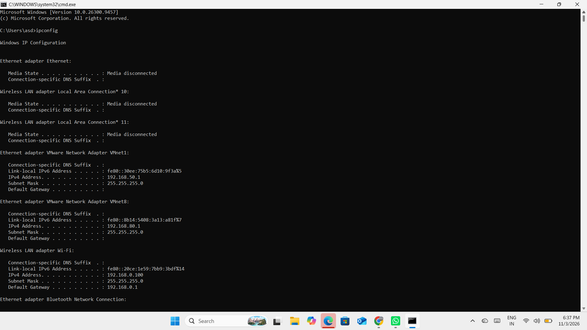
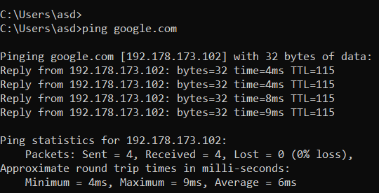
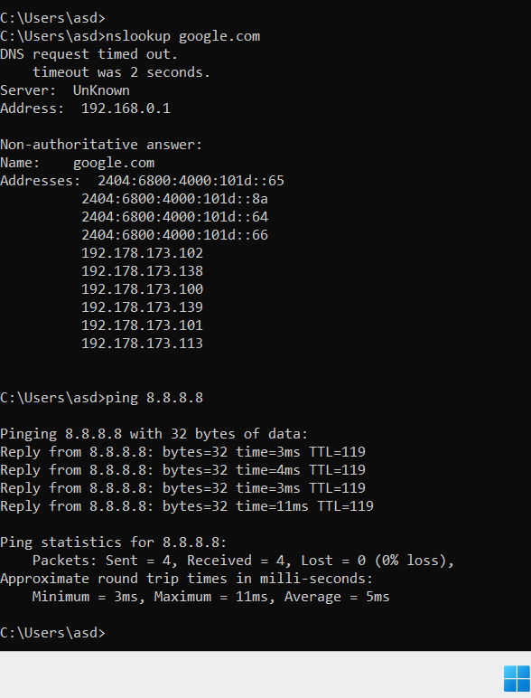

#  Day 01 – Introduction to Computer Networking

##  Overview

Today, I started my Computer Networking learning journey by understanding the basic concepts of networking, how devices communicate, and how to check network connectivity using Windows Command Prompt (CMD).

I also performed hands-on exercises using four basic networking commands: `ipconfig`, `ping`, `nslookup`, and `ping 8.8.8.8`.

---

##  Topics Covered

### 1. What is Computer Networking?

A computer network is a group of two or more devices connected together to communicate, exchange information, and share resources.

### 2. Important Networking Concepts

| Concept | Description |
|---|---|
| Computer Network | Connected devices that communicate and share resources. |
| Client | A device or application that requests services or information. |
| Server | A system that provides services or information to clients. |
| Host | A device connected to a network that can communicate over it. |
| Internet | A worldwide network of interconnected networks. |
| Intranet | A private network used within an organization. |

### 3. How Client-Server Communication Works

1. A client sends a request to a server.
2. The server receives and processes the request.
3. The server sends a response.
4. The client receives and displays the response.

---

##  Practical Hands-on Exercises

Today, I practised four basic networking commands using Windows Command Prompt (CMD).

### 1. ipconfig – Check Network Configuration

**Purpose:**

The `ipconfig` command displays the IP configuration of a Windows computer.

**Command:**

```cmd
ipconfig
```

**Information Observed:**

| Parameter | My Result |
|---|---|
| IPv4 Address (Wi-Fi) | 192.168.0.100 |
| Subnet Mask | 255.255.255.0 |
| Default Gateway | 192.168.0.1 |

**What I Learned:**

- How to check my computer's IP address.
- How to identify the subnet mask.
- How to find the default gateway.
- How to view available network adapters.

**Screenshot:**



---

### 2. ping google.com – Test Network Connectivity

**Purpose:**

The `ping` command checks whether a destination responds over the network.

**Command:**

```cmd
ping google.com
```

**My Results:**

| Parameter | Result |
|---|---|
| Packets Sent | 4 |
| Packets Received | 4 |
| Packets Lost | 0 |
| Packet Loss | 0% |
| Minimum Response Time | 4 ms |
| Maximum Response Time | 9 ms |
| Average Response Time | 6 ms |

**What I Learned:**

- How to check connectivity using a domain name.
- How to observe response time.
- How to identify packet loss.
- How to check whether a destination responds.

**Screenshot:**



---

### 3. nslookup google.com – DNS Lookup

**Purpose:**

The `nslookup` command is used to query DNS servers and find the IP addresses associated with domain names.

**Command:**

```cmd
nslookup google.com
```

**My Observations:**

| Parameter | Result |
|---|---|
| DNS Server IP | 192.168.0.1 |
| DNS Server Name | Unknown |
| Domain Queried | google.com |
| DNS Response | Successfully received after initial timeout |

**What I Learned:**

- DNS stands for Domain Name System.
- DNS translates domain names into IP addresses.
- `nslookup` helps investigate DNS resolution.
- A DNS server can return multiple IPv4 and IPv6 addresses.

**Additional Observation:**

The first DNS request timed out after 2 seconds, but the command subsequently returned DNS records successfully.

**Screenshot:**



---

### 4. ping 8.8.8.8 – Test Connectivity Using an IP Address

**Purpose:**

This command tests network connectivity directly to Google's public DNS server using its IPv4 address.

**Command:**

```cmd
ping 8.8.8.8
```

**My Results:**

| Parameter | Result |
|---|---|
| Packets Sent | 4 |
| Packets Received | 4 |
| Packets Lost | 0 |
| Packet Loss | 0% |
| Minimum Response Time | 3 ms |
| Maximum Response Time | 11 ms |
| Average Response Time | 5 ms |

**What I Learned:**

- How to test connectivity using an IP address.
- How to check whether a destination responds.
- How to observe response time and packet loss.
- How to test connectivity without first resolving a domain name.

**Screenshot:**


---

##  Important Networking Terms Learned

| Term | Meaning |
|---|---|
| IPv4 Address | A numerical address used to identify a device on an IP network. |
| Subnet Mask | Identifies the network and host portions of an IPv4 address. |
| Default Gateway | The device that forwards traffic from a local network to other networks. |
| DNS | Translates domain names into IP addresses. |
| Packet Loss | Packets sent but not successfully received. |
| Response Time | Time taken for a response to return after a request. |
| TTL | Time To Live, a limit used to prevent packets from circulating indefinitely. |

---

##  Key Learnings

- Understood the fundamentals of computer networking.
- Learned the difference between a client, server, and host.
- Understood Internet vs Intranet.
- Learned how client-server communication works.
- Practised four networking commands in Windows CMD.
- Identified my laptop's IPv4 address, subnet mask, and default gateway.
- Understood basic DNS resolution.
- Learned how to test network connectivity using domain names and IP addresses.

##  Tools Used

- Windows 11
- Command Prompt (CMD)

##  Next Learning Topic

**Day 02 – Types of Computer Networks**

- LAN (Local Area Network)
- MAN (Metropolitan Area Network)
- WAN (Wide Area Network)
- PAN (Personal Area Network)

---

##  Learning Journey – Day 01 Completed

Today, I learned basic networking concepts and performed four practical exercises using Windows Command Prompt.

**Learning every day. Practising every day. Growing every day!**

#Networking #ComputerNetworking #NetworkSupport #LearningJourney #Day1
