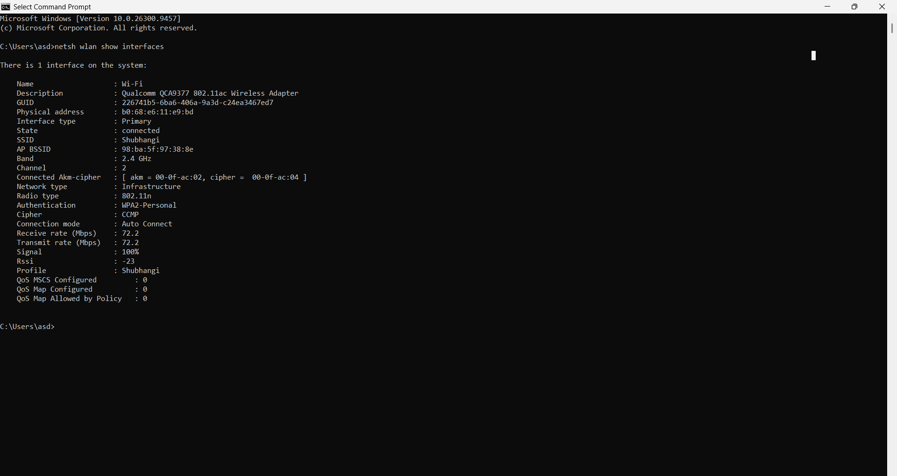
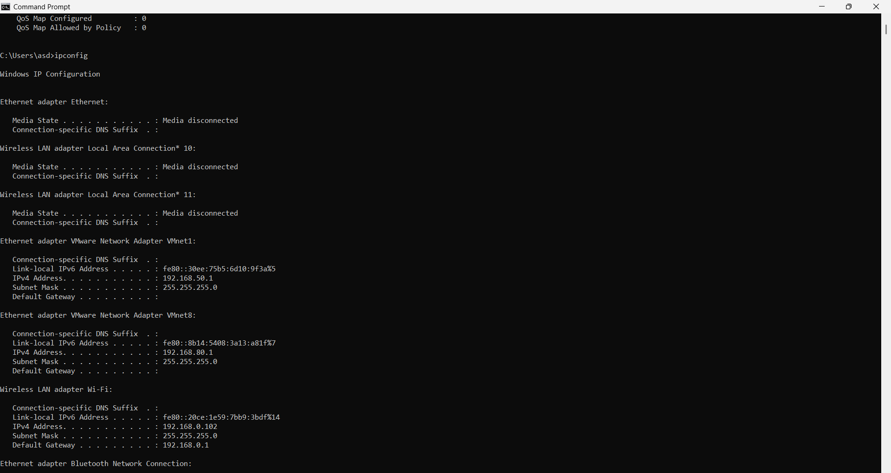
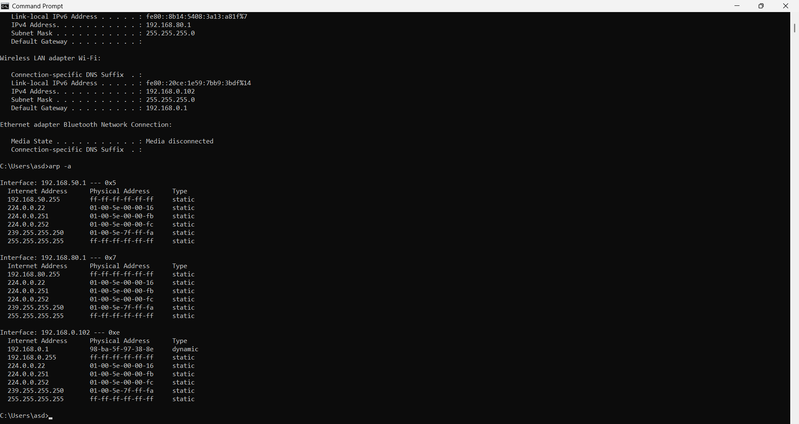

# Day 02 – Types of Computer Networks (PAN, LAN, MAN & WAN)

## Overview

Today, I learned about the different types of computer networks based on their geographical coverage and real-world applications.

I explored PAN, LAN, MAN and WAN, understood the differences between wired and wireless networks, and performed practical networking exercises using Windows Command Prompt.

---

## 1. Types of Computer Networks

### 1.1 PAN – Personal Area Network

**Definition:**

A Personal Area Network (PAN) connects personal devices within a short distance, usually around an individual.

**Examples:**
- Connecting Bluetooth earbuds to a mobile phone.
- Connecting a smartwatch to a smartphone.
- Sharing an Internet connection using a mobile hotspot.

**Technologies Used:**
- Bluetooth
- USB
- NFC

**Real-world Application:**

Connecting a smartphone with wireless headphones using Bluetooth is an example of PAN.

### 1.2 LAN – Local Area Network

**Definition:**

A Local Area Network (LAN) connects computers and other devices within a limited geographical area, such as a home, office, school or building.

**Examples:**
- Home Wi-Fi network.
- Office computer network.
- School computer laboratory.

**Technologies Used:**
- Ethernet
- Wi-Fi
- Network Switches
- Routers
- Access Points

**Real-world Application:**

In an office, multiple computers connect through network switches to share files, printers and other resources.

### 1.3 MAN – Metropolitan Area Network

**Definition:**

A Metropolitan Area Network (MAN) connects multiple LANs across a city or metropolitan area.

**Examples:**
- Connecting different bank branches across Mumbai.
- Connecting university campuses across a city.
- City-wide government networks.

**Technologies Used:**
- Metro Ethernet
- Fiber Optic Cables
- Service Provider Infrastructure

**Real-world Application:**

A bank connecting its branches across different locations in Mumbai is an example of a MAN.

### 1.4 WAN – Wide Area Network

**Definition:**

A Wide Area Network (WAN) connects multiple networks over large geographical distances, such as different cities, states or countries.

**Examples:**
- Connecting company offices in Mumbai, Delhi and London.
- International banking networks.
- Global corporate networks.

**Technologies Used:**
- MPLS
- Leased Lines
- SD-WAN
- VPN
- Fiber Optic Infrastructure

**Real-world Application:**

An international company connecting its offices across different countries using a WAN.

---

## 2. Difference Between PAN, LAN, MAN and WAN

| Feature | PAN | LAN | MAN | WAN |
|---|---|---|---|---|
| Full Form | Personal Area Network | Local Area Network | Metropolitan Area Network | Wide Area Network |
| Coverage | Around a person | Home or building | City | Countries or continents |
| Example | Bluetooth devices | Office network | City-wide bank branches | International company network |
| Technologies | Bluetooth, NFC | Ethernet, Wi-Fi | Metro Ethernet, Fiber | MPLS, SD-WAN, VPN |

### Easy Way to Remember

- PAN – Personal devices.
- LAN – Local area.
- MAN – Metropolitan or city area.
- WAN – Wide geographical area.

---

## 3. Wired and Wireless Networks

### Wired Network

A wired network connects devices using physical cables.

**Example:** Connecting a desktop computer to a network switch using an Ethernet cable.

### Wireless Network

A wireless network connects devices without physical network cables using wireless communication technologies.

**Example:** Connecting a laptop to a Wi-Fi router.

### WLAN – Wireless Local Area Network

WLAN stands for Wireless Local Area Network.

It is a LAN that uses wireless communication, generally Wi-Fi, to connect devices.

**Example:** Connecting laptops and mobile phones to the same home Wi-Fi network.

---

## 4. Practical Hands-on Exercises

Today, I practised three networking commands using Windows Command Prompt (CMD).

### Practical 1: Check Wi-Fi Interface Information

**Command:**

```cmd
netsh wlan show interfaces
```

**Purpose:**

Displays wireless network interface information and connection details.

**My Observations:**

| Parameter | Observed Value |
|---|---|
| Interface Name | Wi-Fi |
| Wireless Adapter | Qualcomm QCA9377 |
| Connection State | Connected |
| Frequency Band | 2.4 GHz |
| Channel | 2 |
| Radio Type | 802.11n |
| Authentication | WPA2-Personal |
| Signal Strength | 100% |
| Receive Rate | 72.2 Mbps |
| Transmit Rate | 72.2 Mbps |

**What I Learned:**
- How to check Wi-Fi connection status.
- How to identify the wireless frequency band.
- How to check the Wi-Fi channel.
- How to observe signal strength and connection speed.
- How to identify wireless authentication methods.

**Screenshot:**



### Practical 2: Check IP Configuration

**Command:**

```cmd
ipconfig
```

**Purpose:**

Displays the IP configuration of Windows network adapters.

**My Observations:**

| Parameter | Observed Value |
|---|---|
| IPv4 Address | 192.168.0.102 |
| Subnet Mask | 255.255.255.0 |
| Default Gateway | 192.168.0.1 |

I also observed VMware virtual network adapters:

- VMnet1: 192.168.50.1
- VMnet8: 192.168.80.1

**What I Learned:**
- How to identify my laptop's IPv4 address.
- How to check the subnet mask.
- How to identify the default gateway.
- How to view physical and virtual network adapters.

**Screenshot:**



### Practical 3: Inspect ARP Cache

**Command:**

```cmd
arp -a
```

**Purpose:**

Displays the ARP cache, which contains IPv4-to-MAC address mappings for known devices and entries on network interfaces.

**My Observations:**

- Identified the default gateway IP address: 192.168.0.1.
- Observed its associated MAC address.
- Observed dynamic and static ARP entries.
- Identified broadcast and multicast addresses.
- Observed separate ARP tables for different network interfaces.

**Important Terms:**

| Term | Description |
|---|---|
| ARP | Address Resolution Protocol |
| IP Address | Logical address used for network communication |
| MAC Address | Link-layer address of a network interface |
| Dynamic Entry | An ARP mapping learned automatically |
| Static Entry | A manually configured or permanent ARP mapping |

**What I Learned:**

ARP helps a device discover the MAC address associated with an IPv4 address on its local network.

**Screenshot:**



---

## 5. Important Networking Concepts Learned

| Concept | Description |
|---|---|
| PAN | Connects personal devices over a short distance. |
| LAN | Connects devices within a limited geographical area. |
| MAN | Connects multiple LANs across a city. |
| WAN | Connects networks over large geographical distances. |
| WLAN | A wireless local area network. |
| SSID | Name of a Wi-Fi network. |
| BSSID | Identifier, commonly the MAC address, of a wireless access point radio. |
| ARP | Resolves IPv4 addresses to MAC addresses on a local network. |
| MAC Address | Link-layer address associated with a network interface. |

---

## 6. Key Learnings

- Understood the four types of computer networks: PAN, LAN, MAN and WAN.
- Learned their geographical coverage and real-world applications.
- Understood the difference between wired and wireless networks.
- Learned about WLAN and Wi-Fi connectivity.
- Practised Windows networking commands.
- Identified Wi-Fi interface information, including frequency band, channel and signal strength.
- Understood the purpose of ARP.
- Learned the difference between IP addresses and MAC addresses.
- Explored dynamic and static ARP entries.

---

## 7. Tools Used

- Windows Command Prompt (CMD)
- Windows 11
- Wi-Fi Network Interface
- VMware Virtual Network Adapters

---

## 8. Next Learning Topic

**Day 03 – Network Topologies**

Topics to explore:

1. What is Network Topology?
2. Bus Topology
3. Star Topology
4. Ring Topology
5. Mesh Topology
6. Tree Topology
7. Hybrid Topology
8. Advantages and Disadvantages of Each Topology

---

## Learning Journey – Day 02 Completed

Today, I strengthened my understanding of network classifications and explored practical networking commands using Windows Command Prompt.

Learning every day. Practising every day. Growing every day!

#Networking #ComputerNetworking #NetworkSupport #NOC #LearningJourney
