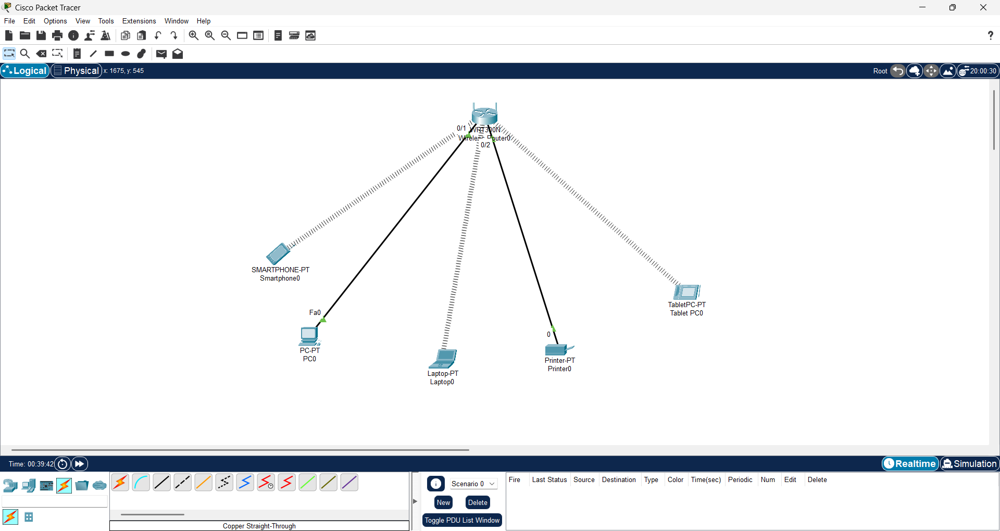
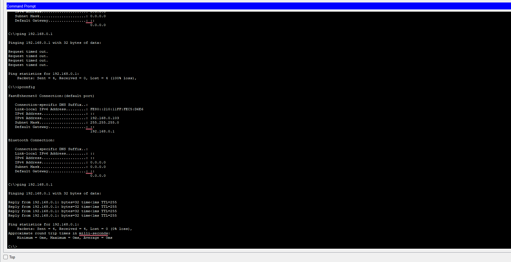
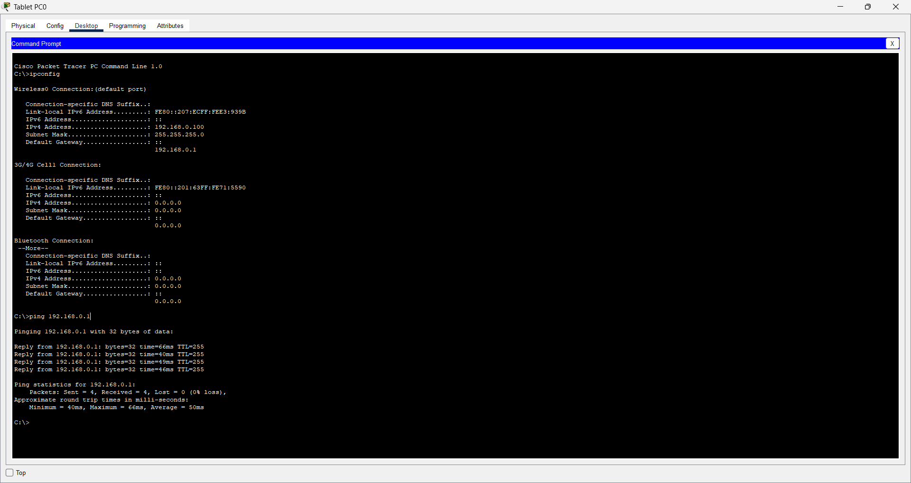

# Day 3: Network Topologies and Home Network Configuration

## 1. Objective

Today, I learned about different network topologies and created a simple home network topology using Cisco Packet Tracer.

I also configured end devices and tested connectivity between devices and the wireless router.

## 2. What is Network Topology?

Network topology refers to the physical or logical arrangement of devices in a computer network and how they communicate with each other.

## 3. Types of Network Topologies

- **Bus Topology:** All devices share one main communication cable.
- **Star Topology:** All devices connect to a central device, such as a switch.
- **Ring Topology:** Devices are connected in a circular arrangement.
- **Mesh Topology:** Devices are connected through multiple paths.
- **Tree Topology:** Devices are arranged in a hierarchical structure.
- **Hybrid Topology:** A combination of two or more topologies.

## 4. Practical Lab: Home Network Topology

**Tool Used:** Cisco Packet Tracer

**Devices Used:**
- Wireless Router (WRT300N)
- PC0
- Laptop
- Smartphone
- Tablet PC
- Printer

### Topology Diagram

I created a simple home network using a wireless router as the central networking device.



### 5. Device Configuration

I configured the PC and printer using DHCP so they could automatically receive IP addresses from the wireless router.

I also connected wireless devices, including the laptop, smartphone and tablet PC, to the home Wi-Fi network.

### 6. Practical Commands and Connectivity Testing

#### Test 1: PC0 IP Configuration

Command used:

```cmd
ipconfig
```

Screenshot:


#### Test 2: Tablet PC IP Configuration

I checked the tablet PC's assigned IP configuration.

Screenshot:


#### Test 3: Ping Test from PC0

Command used:

```cmd
ping 192.168.0.1
```

Purpose: To test connectivity between PC0 and the wireless router.

Result: Successful connectivity.



#### Test 4: Ping Test from Tablet PC

Command used:

```cmd
ping 192.168.0.1
```

Purpose: To test connectivity between the tablet PC and the wireless router.

Result: Successful connectivity.



## 7. Key Learnings

- Understood different types of network topologies.
- Created a home network using Cisco Packet Tracer.
- Learned how to connect wired and wireless devices.
- Configured devices using DHCP.
- Understood how a wireless router connects multiple devices.
- Practised the `ipconfig` and `ping` commands.
- Tested connectivity between end devices and the router.

## 8. Conclusion

This practical helped me understand how devices in a home network connect to a central wireless router and communicate within a local area network.

I also gained hands-on experience with device configuration and basic network troubleshooting using Cisco Packet Tracer.

**Next:** Learning about the OSI Model and TCP/IP Model.
