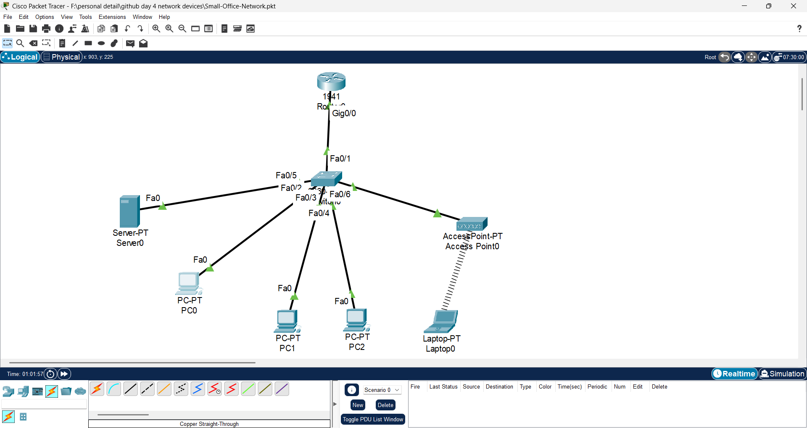
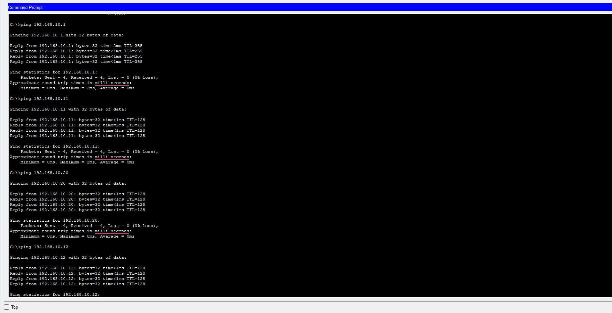
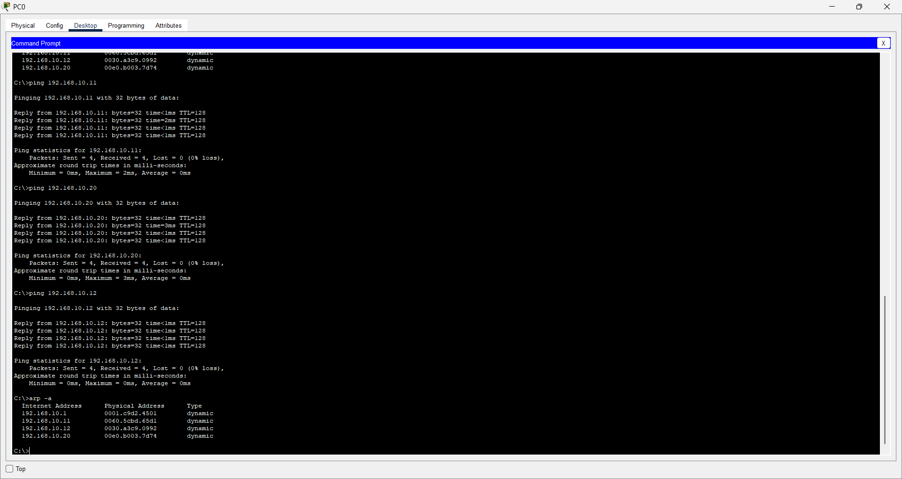
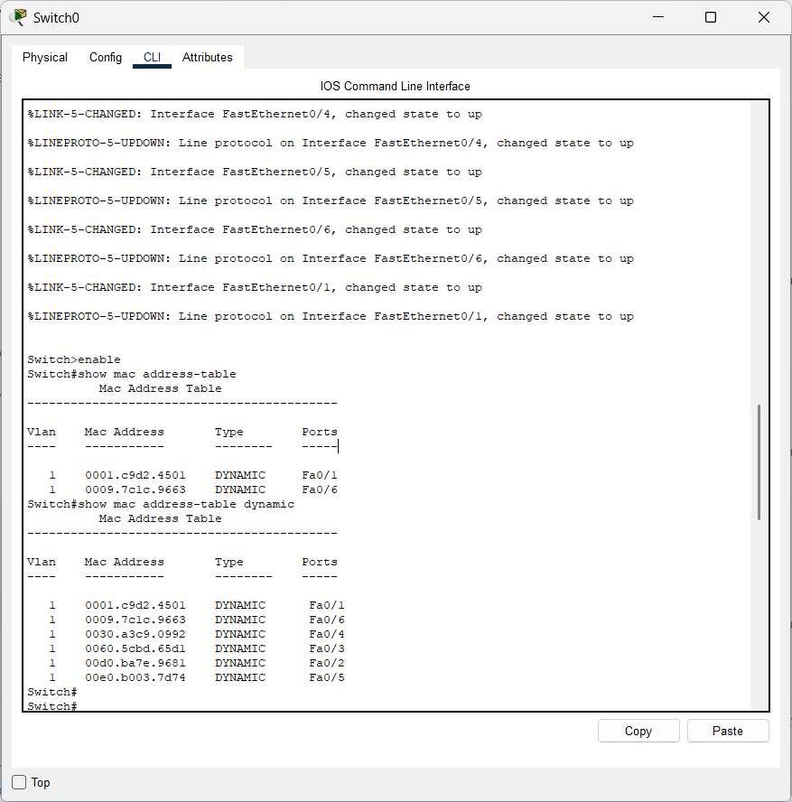

# Day 4: Network Devices and Small Office Network

## 1. Objective

Today, I learned about important networking devices and their functions. I also created a small office network using Cisco Packet Tracer and performed connectivity tests.

## 2. Network Devices Learned

I studied the following networking devices:

1. **Modem:** Connects a network to an ISP using supported access technology.
2. **Router:** Connects different networks and forwards packets using IP addresses.
3. **Switch:** Connects multiple wired devices within a LAN and forwards frames using MAC addresses.
4. **Hub:** Connects devices and broadcasts incoming data to other ports.
5. **Wireless Access Point:** Allows wireless devices to connect to a wired network through Wi-Fi.
6. **Repeater:** Regenerates signals to extend network coverage.
7. **Bridge:** Connects LAN segments and forwards frames based on MAC addresses.
8. **NIC (Network Interface Card):** Provides network connectivity to a computer.
9. **Firewall:** Monitors and filters network traffic based on security rules.
10. **Gateway:** Provides a connection or communication path to another network.
11. **ONT:** Connects fiber-optic broadband to networking equipment.
12. **Server:** Provides services such as file sharing, DNS and DHCP.
13. **Wireless LAN Controller (WLC):** Centrally manages multiple wireless access points.
14. **IDS and IPS:** Detect and help prevent suspicious network activities.

## 3. Practical Lab: Small Office Network

**Tool Used:** Cisco Packet Tracer

### Devices Used

- 1 Cisco 1941 Router
- 1 Cisco 2960 Switch
- 3 PCs
- 1 Server
- 1 Wireless Access Point
- 1 Laptop

### Network Topology

I created a small office LAN where the router connects to a central switch. The switch connects the wired computers, server and wireless access point.

The laptop connects to the network through the wireless access point.



## 4. Router Configuration

Configured the router's GigabitEthernet 0/0 interface with the following settings:

- IP Address: `192.168.10.1`
- Subnet Mask: `255.255.255.0`

Commands used:

```text
enable
configure terminal
hostname Office-Router
interface gigabitEthernet 0/0
ip address 192.168.10.1 255.255.255.0
no shutdown
exit
end
```

## 5. IP Address Configuration

Configured the devices using static IP addressing.

| Device | IP Address |
|---|---|
| Router | 192.168.10.1 |
| PC0 | 192.168.10.10 |
| PC1 | 192.168.10.11 |
| PC2 | 192.168.10.12 |
| Server | 192.168.10.20 |

Subnet Mask: `255.255.255.0`

Default Gateway: `192.168.10.1`

## 6. Connectivity Testing

Used the `ping` command to test communication between network devices.

### Test 1: PC0 to Router

```cmd
ping 192.168.10.1
```

Result: Successful. 4 packets received and 0% packet loss.



### Test 2: PC0 to PC1

```cmd
ping 192.168.10.11
```

Result: Successful. 4 packets received and 0% packet loss.

### Test 3: PC0 to Server

```cmd
ping 192.168.10.20
```

Result: Successful. 4 packets received and 0% packet loss.

### Test 4: PC0 to PC2

```cmd
ping 192.168.10.12
```

Result: Successful. 4 packets received and 0% packet loss.

## 7. Understanding ARP

Used the following command on PC0:

```cmd
arp -a
```

ARP stands for Address Resolution Protocol.

It helps resolve an IPv4 address into the corresponding MAC address on a local network.

The ARP table displayed dynamic entries for the router, PC1, PC2 and server.



## 8. Understanding the Switch MAC Address Table

Used the following command on Switch0:

```text
enable
show mac address-table
```

The switch displayed dynamically learned MAC addresses and their associated ports.



Key learning:

- A switch learns MAC addresses from incoming Ethernet frames.
- It stores MAC addresses in its MAC address table.
- It uses this table to forward frames through the appropriate switch port.

## 9. Important Commands Practised

| Command | Purpose |
|---|---|
| `ipconfig` | Displays IP configuration |
| `ping` | Tests network connectivity |
| `arp -a` | Displays the ARP cache |
| `show mac address-table` | Displays the switch MAC address table |

## 10. Key Learnings

- Understood the functions of important networking devices.
- Learned the difference between a router and a switch.
- Created a small office network in Cisco Packet Tracer.
- Configured router interfaces and static IP addresses.
- Tested communication between computers, router and server.
- Understood ARP and IP-to-MAC address resolution.
- Learned how switches dynamically learn MAC addresses.
- Practised basic network troubleshooting commands.

## 11. Conclusion

Today's practical helped me understand how networking devices work together in a small office network.

I gained hands-on experience with Cisco Packet Tracer, router configuration, IP addressing, connectivity testing, ARP and switch MAC address learning.

**Next Topic:** OSI Model – Understanding the Seven Layers of Network Communication.
