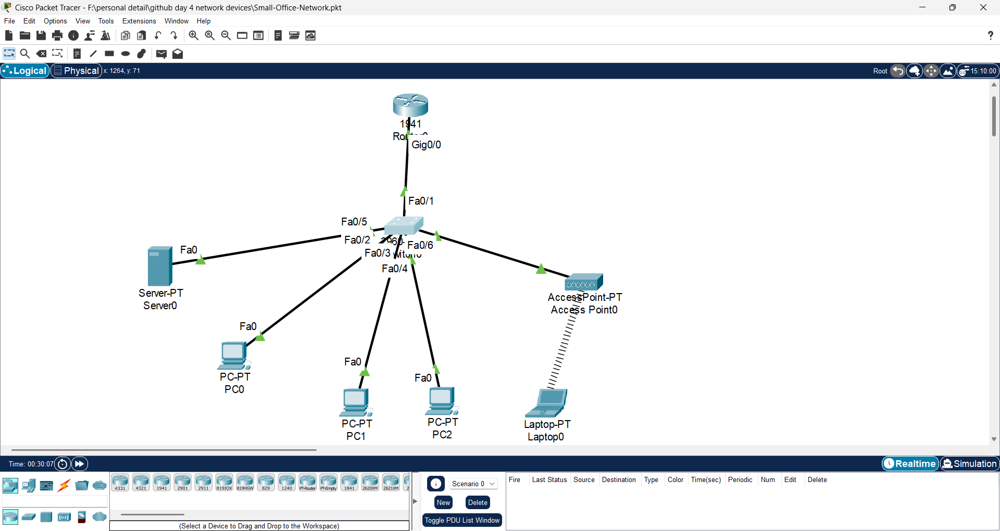
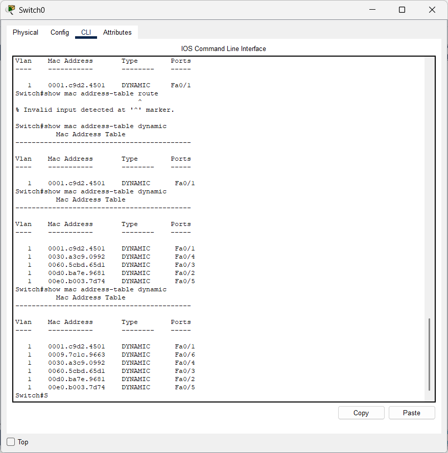
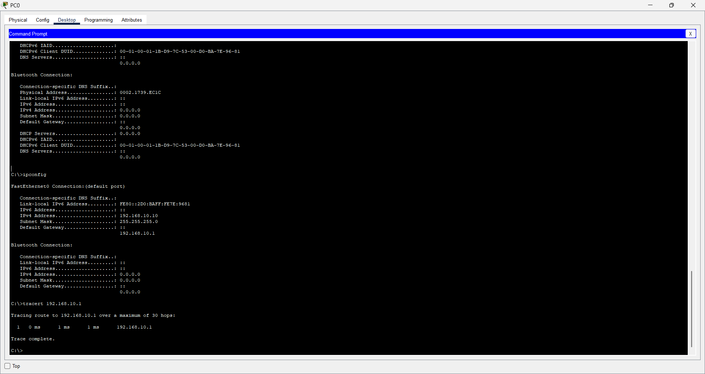
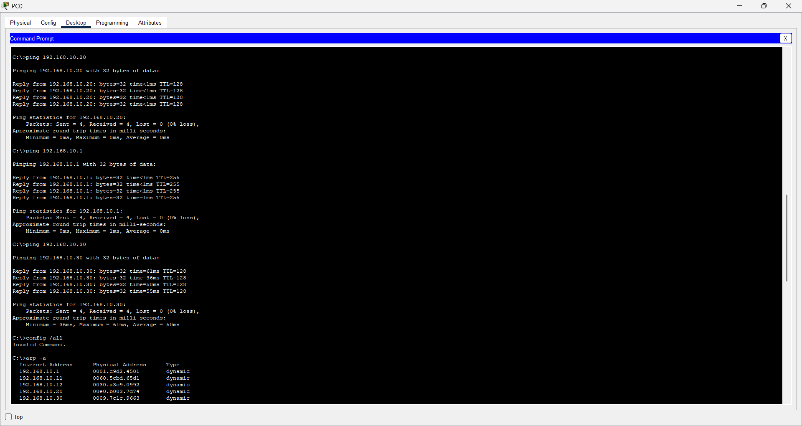
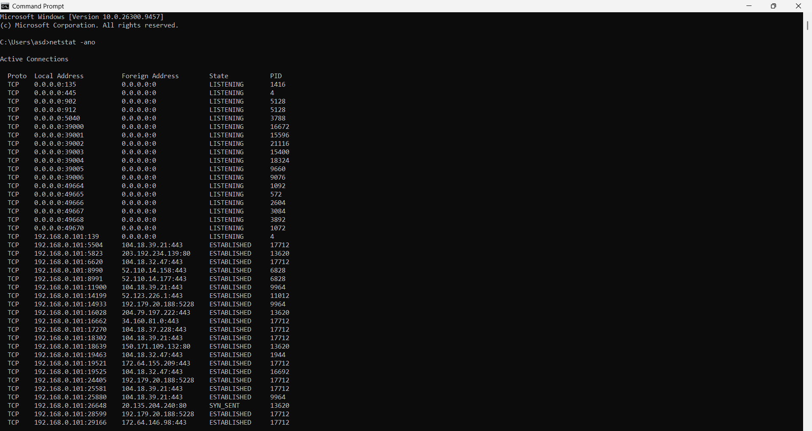
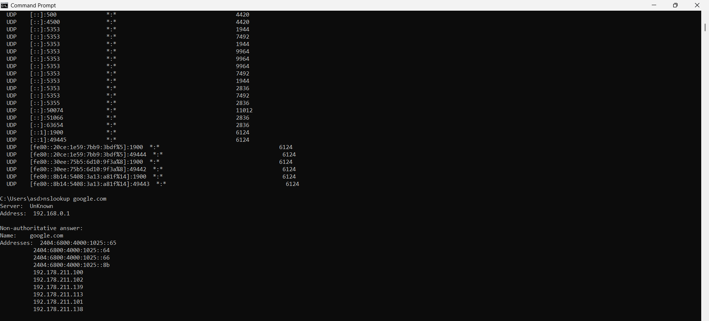

# Day 5: OSI Model and Practical Networking Commands

## 1. Objective

Today, I learned about the OSI (Open Systems Interconnection) Model, its seven layers and their responsibilities.

I also practised networking commands using Windows CMD and Cisco Packet Tracer to understand how devices communicate within a network.

## 2. What is the OSI Model?

OSI stands for Open Systems Interconnection.

It is a reference model that explains how data communication takes place between network devices.

The OSI model consists of seven layers.

## 3. Seven Layers of the OSI Model

| Layer | Name | Main Function | Examples |
|---|---|---|---|
| 7 | Application | Provides network services to applications | HTTP, HTTPS, DNS, FTP |
| 6 | Presentation | Data formatting, encryption and compression | JPEG, ASCII, encryption |
| 5 | Session | Manages communication sessions | Session management |
| 4 | Transport | End-to-end transport and reliability | TCP, UDP |
| 3 | Network | Logical addressing and routing | IP, Routers |
| 2 | Data Link | Frames and MAC addressing | Ethernet, Switches |
| 1 | Physical | Transmits raw bits through physical media | Cables, radio signals |

## 4. Practical Activities

### Practical 1: Physical Layer (Layer 1)

I inspected the physical connections in my small office network created using Cisco Packet Tracer.

Activities:
- Checked Ethernet cable connections.
- Observed link indicators.
- Identified connections between the router, switch, PCs and server.

Screenshot:



### Practical 2: Data Link Layer (Layer 2)

I learned about MAC addresses, ARP and switch MAC address learning.

**Command 1:**

```cmd
arp -a
```

Purpose: Displays the ARP cache, which maps known IPv4 addresses to MAC addresses.

**Command 2:**

```text
show mac address-table
```

Purpose: Displays MAC addresses learned by the switch and their associated ports.

Key learning:
- Switches learn MAC addresses from incoming Ethernet frames.
- Switches maintain a MAC address table.
- ARP helps resolve IPv4 addresses into MAC addresses on a local network.

Screenshot:




### Practical 3: Network Layer (Layer 3)

I practised IP configuration and connectivity testing.

**Command 1:**

```cmd
ipconfig
```

Purpose: Displays the IP address, subnet mask and default gateway.

**Command 2:**

```cmd
ping 192.168.10.1
```

Purpose: Tests connectivity between PC0 and the router.

**Command 3:**

```cmd
tracert 192.168.10.1
```

Purpose: Displays the route taken by packets towards the destination.

Screenshot:





### Practical 4: Transport Layer (Layer 4)

**Command:**

```cmd
netstat -ano
```

Purpose: Displays network connections, listening ports, connection states and process IDs.

Key learning:
- TCP provides connection-oriented and reliable transport.
- UDP provides connectionless transport.
- Port numbers help identify applications and services.

Screenshot:



### Practical 5: Application Layer (Layer 7)

**Command 1:**

```cmd
nslookup google.com
```

Purpose: Queries DNS to resolve a domain name into IP addresses.

**Command 2:**

```cmd
ping google.com
```

Purpose: Tests hostname resolution and network reachability using ICMP.

Screenshot:



## 5. Important Networking Commands Learned

| Command | Purpose |
|---|---|
| `ipconfig` | Displays IP configuration |
| `ipconfig /all` | Displays detailed network information |
| `arp -a` | Displays the ARP cache |
| `ping` | Tests network connectivity |
| `tracert` | Traces the route to a destination |
| `netstat -ano` | Displays network connections and process IDs |
| `nslookup` | Checks DNS resolution |
| `show mac address-table` | Displays the switch MAC address table |

Note: Some commands are supported in Windows CMD but not in the limited Command Prompt available in Packet Tracer.

## 6. Key Learnings

- Understood the purpose of the OSI Model.
- Learned the seven OSI layers and their responsibilities.
- Understood the difference between IP addresses and MAC addresses.
- Learned how switches dynamically learn MAC addresses.
- Practised ARP and DNS commands.
- Tested network connectivity using ping.
- Explored network connections using netstat.
- Connected networking commands with OSI layer concepts.

## 7. Conclusion

Today's learning helped me understand how the OSI Model explains network communication.

By combining theoretical knowledge with practical commands, I gained a better understanding of IP addressing, MAC addressing, network connectivity, switching and DNS resolution.

**Next Topic:** TCP/IP Model and its comparison with the OSI Model.
