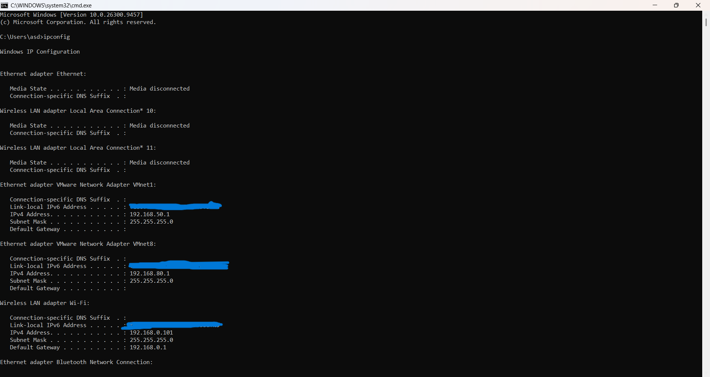
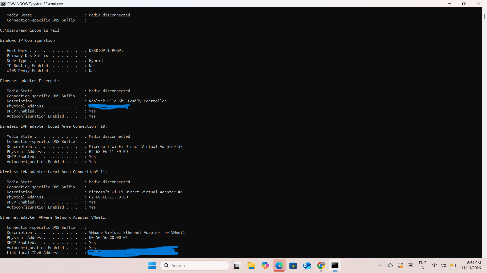
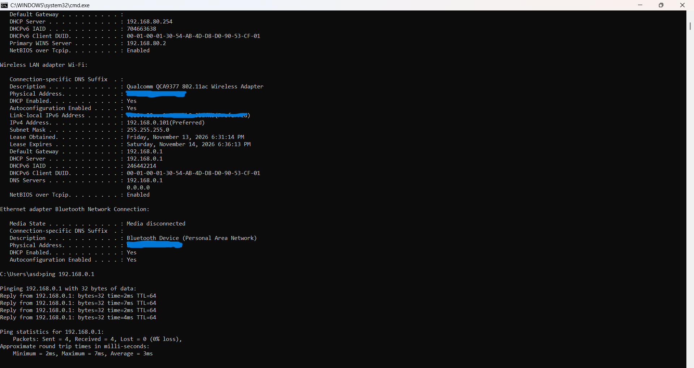

# Day 6: IP Addressing – IPv4 and IPv6

## Overview
On Day 6 of my Computer Networking Learning Journey, I studied IP addressing and performed practical exercises using Windows Command Prompt.

## Topics Covered

### 1. What is an IP Address?
An IP (Internet Protocol) address is a logical address assigned to a device connected to a network. It helps devices identify and communicate with each other.

### 2. IPv4
- IPv4 stands for Internet Protocol Version 4.
- Uses 32-bit addressing.
- Contains four octets separated by dots.
- Example: `192.168.0.101`

### 3. IPv6
- IPv6 stands for Internet Protocol Version 6.
- Uses 128-bit addressing.
- Uses hexadecimal characters separated by colons.
- Example: `2001:db8::1`

### 4. Public IP vs Private IP
- Private IP addresses are used inside local networks.
- Public IP addresses are used for communication over the public internet.
- Private IPv4 ranges:
  - `10.0.0.0/8`
  - `172.16.0.0/12`
  - `192.168.0.0/16`

### 5. Static IP vs Dynamic IP
- Static IP: Configured manually or reserved to remain consistent.
- Dynamic IP: Automatically assigned by a DHCP server.

## Practical Exercises

I used Windows Command Prompt to inspect my network configuration.

### Commands Practised

```cmd
ipconfig
```
Displays basic IP configuration.

```cmd
ipconfig /all
```
Displays detailed network adapter information, including DHCP, DNS and physical adapter details.

```cmd
ping 192.168.0.1
```
Tests connectivity between my laptop and default gateway.

## Practical Results

My active Wi-Fi adapter showed:

| Parameter | Result |
|---|---|
| IPv4 Address | `192.168.0.101` |
| Subnet Mask | `255.255.255.0` |
| Default Gateway | `192.168.0.1` |
| DHCP Enabled | Yes |
| DHCP Server | `192.168.0.1` |
| DNS Server | `192.168.0.1` |

The IPv4 address belongs to the private IP address range.

I also identified VMware virtual network adapters:
- VMnet1: `192.168.50.1`
- VMnet8: `192.168.80.1`

### Ping Test Results

Command: `ping 192.168.0.1`

| Parameter | Result |
|---|---:|
| Packets Sent | 4 |
| Packets Received | 4 |
| Packets Lost | 0 |
| Packet Loss | 0% |
| Average Round Trip Time | 3 ms |

The successful ping confirmed communication between my laptop and home router.

## Key Learnings
- Understood IPv4 and IPv6 addressing.
- Learned the difference between public and private IP addresses.
- Understood static and dynamic IP addressing.
- Identified DHCP and DNS information using `ipconfig /all`.
- Practised testing local network connectivity using `ping`.
- Identified virtual network adapters created by VMware.

## Screenshots

### 1. IP Configuration


### 2. Detailed IP Configuration


### 3. Default Gateway Ping Test


## Conclusion
Day 6 helped me understand how IP addresses identify devices on a network. I also performed practical network configuration checks and successfully tested connectivity to my home router.

Next: Day 7 – Subnet Mask.
